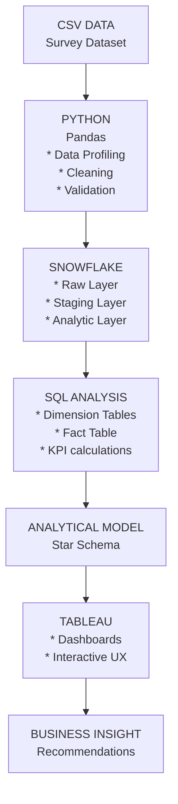

# Post-Pandemic Remote Work Employee Well-Being BI Analysis
## Business objective
Analyze how remote and hybrid work arrangements affect employee mental health, burnout, work-life balance, physical health, and social isolation, and identify the employee groups most at risk.

Questions:
* Does remote work have a measurable relationship with burnout?
* Which work arrangement has the best work-life balance?
* Which industries have the highest burnout?
* Does working longer hours correlate with poorer well-being?
* Which age groups report the greatest mental-health challenges?
* How does social isolation vary by work arrangement?
* Are certain job roles or salary groups more affected?
* Which employee segments should organizations prioritize for intervention?
## Technology stack
|Layer|Tool|Purpose|
|-----|----|--------|
|Data source| CSV| Raw survey data|
|Data cleaning |Python / Pandas| Profiling, cleaning, validation|
|Database| SnowFlake|Data storage + SQL transformations|
|ETL| Python| Load cleaned data into PostgreSQL|
|Data modelling|Snowflake|Star schema / analytical layer|
|BI|Tableau|Dashboard|
|Version control| Git| Track development|
|Repository| GitHub|Portfolio + documentation|
|Documentation| Markdown| README, methodology|

## The architecture 

## Business problem
Organizations adopted remote and hybrid working arrangements after COVID-19, but the impact on employee well-being is not uniform.

Management wants to understand:

*“Which working conditions and employee segments are associated with poor employee well-being?”*

## Stakeholders

#### HR Leadership
Interested in:
* burnout
* mental health
* employee retention risk
* work-life balance
  
#### People Managers
Interested in:
* workload
* working hours
* team well-being
* social isolation

#### Executive Leadership
Interested in:
* organization-wide trends
* high-risk employee segments
* intervention priorities
